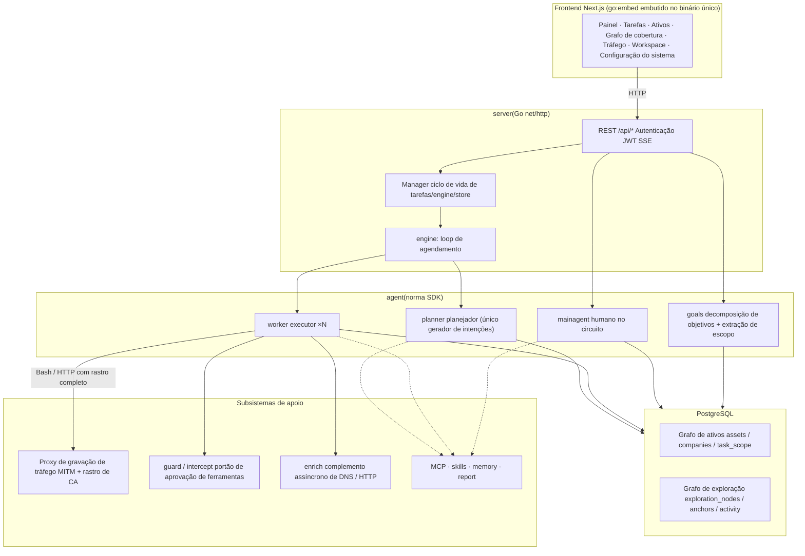
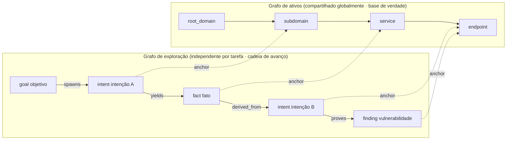
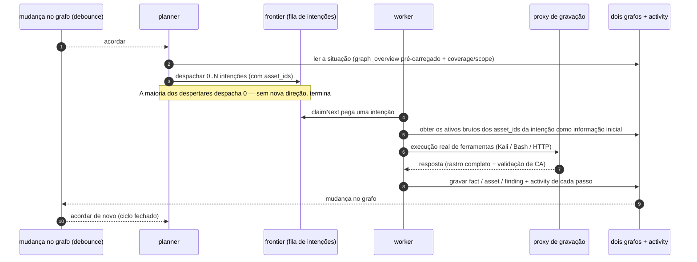
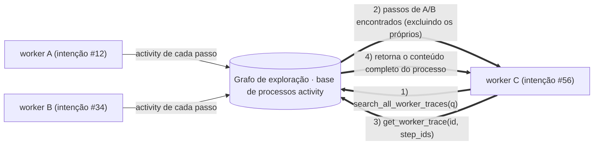
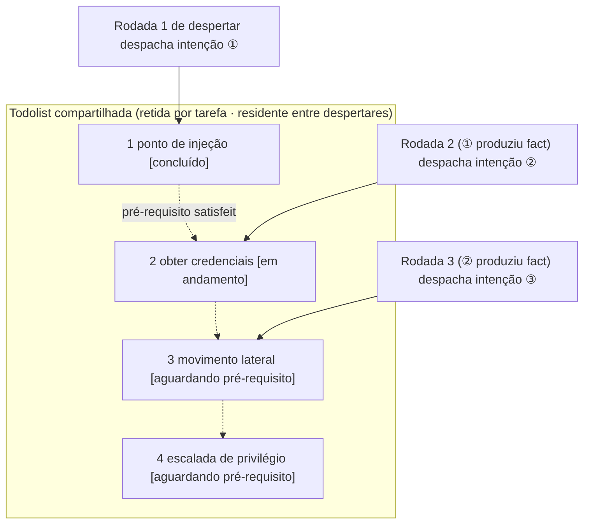

<div align="center">

# ARTEX

Sistema de pentest autônomo com IA (backend em Go + frontend em Next.js)


🌐 **Demo online**: [https://artex-demo.vercel.app/](https://artex-demo.vercel.app/)

</div>

---

## Prévia das telas

> A interação completa está na [demo online](https://artex-demo.vercel.app/).

| Painel (visão geral / consumo de Tokens / fluxo de atividades) | Lista de tarefas |
| :---: | :---: |
|  |  |

| Tarefa · processo de execução (sessões / chamadas de ferramentas) | Cadeia de exploração |
| :---: | :---: |
|  |  |

| Achados | Ativos |
| :---: | :---: |
|  |  |

| Grafo de cobertura de ativos (layout por forças · testados em destaque · nós recolhíveis/expansíveis) |
| :---: |
|  |

| Gravação de tráfego | Conversa com humano no circuito |
| :---: | :---: |
|  |  |

| Gerenciamento de Agents | Configuração de LLM |
| :---: | :---: |
|  |  |

| Aprovação de interceptação | Logs do backend |
| :---: | :---: |
|  |  |


---

## Detalhes do registro de aprovações

O "Registro de aprovações" global, a "Aprovação de interceptação" dentro da tarefa e os cartões de aprovação na conversa permitem expandir para ver os detalhes. A estrutura de exibição tem como referência
[o componente de detalhes de aprovação do AegisHook](https://github.com/RuoJi6/AegisHook/blob/main/web/src/components/CallDetail.vue), reaproveitando os componentes e o tema do ARTEX:


## Sincronização de ativos (ScopeSentry)

Permite sincronizar dados de ativos diretamente do [ScopeSentry](https://github.com/Autumn-27/ScopeSentry), evitando coleta repetida:

- Na página "**Sincronização de ativos**", informe o endereço e a API Key do ScopeSentry para conectar a fonte de dados;
- Escolha, por **projeto** ou por **tarefa**, os alvos e os tipos de ativos a sincronizar (domínio / subdomínio / IP / porta / site / endpoint…);
- Importe com um clique e consolide conforme o escopo de ativos da empresa, entrando direto no grafo de ativos do ARTEX para os agents explorarem.

---

## Instalação

> Depende do banco de dados **PostgreSQL**; a exploração exige configurar um **LLM** (`ANTHROPIC_API_KEY` ou `OPENAI_API_KEY`, também configurável na UI).

### Opção 1: script de instalação com um clique (recomendado)

```bash
git clone https://github.com/Hinln/ARTEX.git
cd ARTEX
./install.sh
```

O script: detecta / instala automaticamente o Docker → deixa você escolher **① tudo em Docker** ou **② compilar e executar localmente**:

- **① Tudo em Docker**: informe uma senha do Postgres (Enter para gerar aleatória) → grava o `.env` automaticamente → `docker compose up -d`.
- **② Execução local**: escolha o banco de dados (conectar a um existente / subir um com Docker) → gera o `config.json` → compila com `go` o binário único embutido → inicia.

Depois de instalar, abra **http://localhost:8787** (no primeiro acesso, vá a `/setup` para definir a senha do administrador).

### Opção 2: Docker Compose (manual)

```bash
git clone https://github.com/Hinln/ARTEX.git
cd ARTEX
cp .env.example .env          # preencha POSTGRES_PASSWORD e, opcionalmente, ANTHROPIC_API_KEY
docker compose up -d          # baixa a imagem autumn27/artex + postgres
# → http://localhost:8787
```

A imagem já inclui as ferramentas comuns (ripgrep/curl/vim/npm/nmap…); `./skills` e `./data` são persistidos por bind mount.

No MCP remoto, nas configurações do sistema é possível escolher `http` (Streamable HTTP) ou `sse` (SSE legado).
Serviços SSE legados normalmente usam `GET /sse` para abrir o fluxo de eventos e recebem as requisições JSON-RPC por
`/message?sessionId=...` retornado pelo serviço; na configuração, informe a URL como `/sse` e preencha o cabeçalho de requisição como
`Authorization=Bearer <token>`.

### Opção 3: baixar o binário pré-compilado (Releases)

Baixe o zip da plataforma correspondente em [Releases](https://github.com/Hinln/ARTEX/releases); ao descompactar você obtém `artex` + `start.sh` (no Windows, `start.bat`) + `skills/` + `config.example.json`:

```bash
cp config.example.json config.json   # preencha a conexão do database
./start.sh                           # → http://localhost:8787
```

> Inicie com `start.sh` / `start.bat`, e não executando `./artex` diretamente. Ele é um script daemon: depois que o programa sai, decide pelo código de saída se deve subir de novo; **a [atualização com um clique](#opção-1-atualização-com-um-clique-pela-página-recomendado) pela página depende dele para concluir a troca**. Executando `./artex` direto, ele não será reiniciado após a atualização.
> Execução em segundo plano: `nohup ./start.sh >artex.log 2>&1 &`.

### Opção 4: compilar o binário único a partir do código-fonte

```bash
# 1) Exportação estática do frontend
cd web && npm ci && npm run build:static && cd ..
# 2) Copiar para o diretório embutido
cp -r web/out server/webui/dist
# 3) Compilar (só com -tags embedui o frontend é embutido)
CGO_ENABLED=0 go build -tags embedui -o artex ./cmd/artex
./start.sh
```

### Opção 5: gerar o pacote compactado de Release multiplataforma

O `build.sh` primeiro constrói e embute o frontend, depois usa o linker do Go para remover informações de depuração e compacta os arquivos de release em zip. O modo Release gera por padrão pacotes zip para Linux amd64/arm64, macOS amd64/arm64 e Windows amd64:

```bash
./build.sh --release
# Artefato: dist/artex-0.3.3-*.zip
```

O binário auto-extraível do UPX pode ser incompatível com alguns kernels Linux, ambientes virtualizados ou políticas de segurança, por isso não vem ativado por padrão. Use `ARTEX_TARGETS` para personalizar os alvos; quando tiver certeza de que o ambiente de execução alvo é compatível, é possível passar `--upx` explicitamente para reduzir ainda mais o binário:

```bash
ARTEX_TARGETS=linux/amd64,windows/amd64 ./build.sh --release
./build.sh --target linux/amd64 --upx
```

---

## Atualização e upgrade

> O upgrade troca apenas o programa e não mexe nos dados: o volume de dados do Postgres `pgdata`, `./data` (jwt.key / SQLite etc.) e `./skills` são todos preservados. **A migração do banco de dados não precisa ser executada manualmente** — a cada inicialização o `artex` reexecuta de forma idempotente o `schema.sql` (com `ADD COLUMN` / `CREATE INDEX IF NOT EXISTS`), ou seja, "reiniciou, migrou". Mesmo assim, antes do upgrade recomenda-se fazer backup de `./data` e do banco de dados.

### Fonte de atualização por Release privado deste repositório

A atualização com um clique pela página verifica e baixa versões sempre de [Hinln/ARTEX Releases](https://github.com/Hinln/ARTEX/releases). Clonar ou atualizar o código-fonte via Git também usa `Hinln/ARTEX`; o caminho do módulo Go do projeto original permanece inalterado.

Este é um repositório privado. Defina `ARTEX_UPDATE_GITHUB_TOKEN` para o processo de backend que executa o ARTEX; o token só precisa da permissão **Contents: read** deste repositório. O token é usado pelo backend para consultar Releases e baixar anexos, não é enviado ao navegador, e também não deve ser commitado no Git.

```bash
# Antes, defina com segurança ARTEX_UPDATE_GITHUB_TOKEN no shell atual ou no ambiente do serviço
./start.sh
```

Ao iniciar localmente de forma direta, o `start.sh` não lê o `.env` automaticamente; a variável precisa ser exportada para o ambiente do processo. Em implantações com Docker Compose, é possível preencher essa variável no `.env` (que não está no Git) e recriar o contêiner do artex; a imagem precisa conter o código de atualização desta branch, e uma imagem antiga não troca a fonte de upgrade por isso.

É preciso antes publicar neste repositório um Release oficial que não seja draft nem prerelease, com os anexos `artex-<versão>-<os>-<arch>.zip` e `SHA256SUMS`, para que a página ofereça uma atualização instalável. Com apenas o código-fonte no repositório, ainda não é possível fazer upgrade online. O workflow de Release existente gera esses anexos para o repositório atual ao enviar uma tag `v*`.

### Opção 1: atualização com um clique pela página (recomendado)

Na página **Configuração do sistema** (barra lateral "Configuração do sistema" → `/system/settings`), no cartão **Versão e atualização**, é possível verificar e instalar diretamente a nova versão, sem precisar entrar no servidor.

Ao clicar em "Atualizar": baixa o pacote de release da plataforma atual → compara com o `SHA256SUMS` do Release → faz um smoke test do novo binário com `-h` → coloca em staging como `artex.new` → o programa sai e o `start.sh` / `start.bat` o sobe de novo e conclui a troca. A página aguarda automaticamente a nova versão ficar no ar e recarrega.

- **Falha não deixa um programa quebrado**: se a verificação ou o smoke test não passar, o arquivo em staging é descartado e a versão atual continua rodando; se a nova versão após a troca falhar em 3 inicializações seguidas, há rollback automático para `artex.old` (a que falhou fica como `artex.failed` para investigação).
- **Sempre é possível voltar**: a versão anterior é mantida como `artex.old`, e o cartão tem "Reverter para a versão anterior". Atenção: a estrutura do banco de dados não é revertida.
- **A atualização interrompe as tarefas em execução** — atualizar é reiniciar, faça isso quando estiver ocioso.
- **Builds de desenvolvimento não recebem atualização**: fica desativado quando a versão é `dev` ou o `git describe` vem com sufixo, para evitar que uma versão oficial sobrescreva o binário de depuração local.
- **No Docker só o programa é trocado, não a imagem**: as ferramentas como playwright / nmap dentro da imagem não são atualizadas, e depois de recriar o contêiner com `docker compose up -d` volta-se à versão que vem na imagem. Para atualizar também a imagem, continue usando `docker compose pull artex && docker compose up -d artex`.
- Se o acesso ao GitHub exigir proxy, configure o **proxy global** na mesma página e o fluxo de atualização passará por ele. A atualização só baixa de domínios do GitHub e força HTTPS.

### Opção 2: script de atualização com um clique

```bash
cd ARTEX
./update.sh
```

O script primeiro oferece, opcionalmente, um `git pull` para trazer o código mais recente, e depois deixa você escolher **① atualização Docker** ou **② atualização por compilação local** (correspondente ao `install.sh`):

- **① Docker**: é possível indicar a tag da imagem alvo (Enter mantém o `ARTEX_TAG` do `.env`, padrão `latest`) → `docker compose pull` → `docker compose up -d` (reiniciar com a imagem nova migra automaticamente).
- **② Local**: reconstrói os artefatos estáticos do frontend → recompila o `./artex` (reinicie o processo depois para entrar em vigor).

### Opção 3: Docker Compose (manual)

```bash
cd ARTEX
git pull                       # atualiza compose / scripts (opcional)
# Para fixar a versão: defina ARTEX_TAG=v0.2.0 no .env; sem definir, usa latest
docker compose pull artex
docker compose up -d artex     # reinicia com a imagem nova → migra o schema automaticamente
docker image prune -f          # limpa imagens antigas (opcional)
```

### Opção 4: binário pré-compilado (Releases)

Baixe o zip da nova versão em [Releases](https://github.com/Hinln/ARTEX/releases), pare o processo antigo e sobrescreva `artex` e `skills/` (mantendo seu `config.json` e `data/`); basta reiniciar:

```bash
cp -r <diretório-extraído>/skills ./ && cp <diretório-extraído>/artex ./
./start.sh
```

### Opção 5: compilar a partir do código-fonte

```bash
git pull
cd web && npm ci && npm run build:static && cd ..
cp -r web/out server/webui/dist
CGO_ENABLED=0 go build -tags embedui -o artex ./cmd/artex
# reinicie o ./start.sh
```

---

## Configuração

**Banco de dados** (`config.json`, ou sobrescreva com a variável de ambiente `ARTEX_PG_DSN`):

```json
{
  "database": {
    "host": "127.0.0.1", "port": 5432,
    "user": "artex", "password": "yourpass",
    "dbname": "artex", "sslmode": "disable"
  }
}
```

**LLM**: `export ANTHROPIC_API_KEY=sk-...` (ou `OPENAI_API_KEY`), também é possível preencher na página "Configuração de LLM" da UI.
Opcionais: `ARTEX_LLM_PROVIDER` / `ARTEX_LLM_MODEL` / `ARTEX_LLM_BASE_URL` / `ARTEX_LLM_PROXY`.

**Concorrência**: o número de work agents por tarefa é configurado em "Configurações do sistema" (padrão 3).

**Parâmetros comuns**: `./start.sh -addr :8787 -proxy :8788` (`-addr` frontend+API, `-proxy` proxy de gravação de tráfego). O script de inicialização repassa os parâmetros inalterados ao `artex`.

### Implantação com proxy reverso (HTTPS / abrindo só a 443)

O frontend e a API/SSE são servidos pela mesma porta do backend (padrão `:8787`); o fluxo de atividades em tempo real usa por padrão o endereço de **mesma origem**, portanto **não é preciso configurar `NEXT_PUBLIC_SSE_BASE`**: basta expor só a 443 na rede pública e manter a 8787 na rede interna.

O SSE é uma conexão longa com envio contínuo, e o proxy reverso **precisa desativar o buffering**, caso contrário o navegador conecta mas não recebe eventos (o sintoma é o fluxo de atividades girando sem parar). Exemplo com Nginx:

```nginx
server {
    listen 443 ssl;
    server_name your.domain.com;
    # ssl_certificate / ssl_certificate_key ...

    location / {
        proxy_pass http://127.0.0.1:8787;
        proxy_set_header Host $host;
        proxy_set_header X-Forwarded-Proto $scheme;

        # Pontos-chave do SSE: desligar buffering, timeout longo, HTTP/1.1
        proxy_buffering off;
        proxy_cache off;
        proxy_read_timeout 3600s;
        proxy_http_version 1.1;
        proxy_set_header Connection "";
    }
}
```

> Só quando o SSE precisar sair por uma origem diferente da página (por exemplo, um subdomínio separado) é que se deve definir `NEXT_PUBLIC_SSE_BASE` **em tempo de build** (essa variável é fixada no pacote estático durante o `next build`; definir depois, na execução do contêiner, não tem efeito).

---


## Desenvolvimento

### Reteste manual de vulnerabilidades

A aba "Reteste" nos detalhes da tarefa permite selecionar, com paginação, as vulnerabilidades desta tarefa, ver conclusões e evidências anteriores e iniciar manualmente um reteste. Depois de iniciado, a aba atual é mantida, exibindo um ícone giratório e "Retestando"; ao confirmar a correção, o status da vulnerabilidade é atualizado em conjunto.

Clique em "Reteste" na área de ações de cada linha da lista de vulnerabilidades, ou em "Iniciar reteste" na área "Reteste de vulnerabilidade" dos detalhes da vulnerabilidade, preencha opcionalmente a versão corrigida, as condições de teste ou restrições, e o sistema cria uma sessão de Agent de reteste independente, mantendo a página atual após iniciar. As visões plana, agrupada por tarefa e por ativo da lista oferecem essa entrada; durante o reteste exibe-se um ícone giratório e "Retestando", e quando precisar ver, clique para entrar na sessão correspondente; ao terminar volta a "Reteste". O reteste não exige reiniciar a tarefa de varredura original; a conclusão se divide em "Ainda reproduzível", "Corrigida" e "Não foi possível confirmar", e a conclusão, as evidências e o link da sessão de cada execução ficam salvos nos detalhes da vulnerabilidade.

Na primeira inicialização, o novo backend pré-cadastra o Agent editável "Reteste de vulnerabilidade" (`retester`), cujos prompt, LLM, orçamento de execução e ferramentas podem ser configurados no Gerenciamento de Agents. Por padrão usa o LLM vinculado a ele; se não houver vínculo, usa a configuração ativa global. Quando a sessão de reteste termina com sucesso e a conclusão é "Corrigida", o sistema altera automaticamente o status de tratamento da vulnerabilidade para "Corrigida"; em execução, falha, parada ou outras conclusões, o status original é mantido. As evidências e o relatório originais são sempre preservados. Também é possível escolher manualmente "Corrigida" no menu suspenso de status. Se a mesma vulnerabilidade já estiver em reteste, a sessão existente é reutilizada, e após parada, falha ou reinício do serviço é possível iniciar de novo.

Nesta versão o histórico é consultado pelos detalhes da vulnerabilidade e pelas sessões; ainda não entra na exportação de relatórios de vulnerabilidades nem no pacote de arquivamento de tarefas, e também não é associado automaticamente a pacotes de tráfego. O modo demonstração só gera registros simulados claramente identificados, sem requisitar alvos reais.

### Execução e testes locais

```bash
./dev.sh    # backend (:8787) + proxy de tráfego (:8788) + frontend next dev (:5173) → http://localhost:5173
```

- Backend: `go run ./cmd/artex` (sem `-tags embedui` o frontend não é embutido)
- Frontend: `cd web && npm run dev` (`/api` passa por proxy reverso para o backend, com hot reload)
- Testes: `go test ./...`
- Preview com Mock (sem backend): `cd web && NEXT_PUBLIC_MOCK=1 npm run dev`

---

## Arquitetura técnica do sistema

O ARTEX é um **sistema de pentest autônomo conduzido por LLM multi-agent**: backend monolítico em Go (com frontend Next.js embutido) + PostgreSQL; a capacidade dos agents é fornecida pelo SDK [`norma`](https://github.com/Autumn-27/norma) (`agentcore` / `tool` / `permission` / `harness` / `memory` / `transcript`). O núcleo é a **arquitetura de dois grafos**, mais dois mecanismos de autonomia em torno dela: a **troca de informações em nível de processo entre workers** e a **todolist compartilhada de múltiplas rodadas do planner para estabilizar a cadeia de ataque**.

### Camadas gerais



| Camada | Responsabilidade |
| --- | --- |
| **Frontend** | Exportação estática do Next.js, embutido no binário único via `go:embed`; visualiza tarefas/ativos/cadeia de exploração/grafo de cobertura e a conversa com humano no circuito |
| **server** | Rotas `net/http` + autenticação JWT + SSE; o `Manager` gerencia o ciclo de vida de tarefas, engine e DB store |
| **engine** | Um `plannerLoop` por tarefa + N goroutines de worker; captura de intenções, timeout/pausa/drain |
| **agent** | goals / planner / worker / mainagent; o `ToolSet` expõe os dois grafos como ferramentas de LLM |
| **db** | Persistência dos dois grafos no Postgres (pgx); o schema é criado de forma idempotente a cada inicialização via `go:embed` |
| **Apoio** | Proxy MITM de gravação, portão de aprovação, complemento assíncrono, MCP/skills/memória/relatórios |

### Arquitetura de dois grafos: grafo de exploração + grafo de ativos

O sistema separa "**qual é o alvo**" e "**até que ponto foi testado**" em dois grafos independentes entre si, mas ligados por âncoras:

- **Grafo de ativos (Asset Graph, compartilhado globalmente)**: a base de verdade de ativos, única e compartilhada entre tarefas. Os nós são `root_domain / subdomain / ip / service / app / endpoint`, pertencentes a uma empresa; as relações pai-filho domínio→subdomínio→serviço→endpoint e as chaves de deduplicação são todas calculadas pelo programa, e o agent apenas envia informações brutas.
- **Grafo de exploração (Exploration Graph, independente por tarefa)**: o processo de "raciocínio e avanço" de uma tarefa. Os nós são `goal (objetivo) / intent (intenção) / fact (fato) / finding (vulnerabilidade) / hint (dica)`, ligados por arestas como `spawns / derived_from / yields / proves` formando uma **cadeia de linhagem**, que responde "qual direção derivou de quais fatos e o que produziu".
- **Os dois grafos se ligam por âncoras**: `exploration_anchors(node_id, asset_id)` ancora intenções/fatos/vulnerabilidades em ativos concretos — assim é possível, a partir de uma "direção de exploração", ver quais ativos ela atacou, e também, a partir de "um ativo", consultar por quais intenções ele foi testado nesta tarefa e quais fatos foram obtidos. Isso também sustenta a **cobertura de testes de ativos** e o **grafo de cobertura de ativos** (ativos no escopo + testados em destaque).



> Divisão de trabalho: o **planner** lê a situação do grafo de exploração, avalia o objetivo e só despacha **intenções** para o frontier quando há uma nova direção não coberta; o **worker** pega **uma intenção**, executa com ferramentas reais, grava de volta nos dois grafos os novos ativos/fatos/vulnerabilidades e para. O grafo de ativos é o fato compartilhado, o grafo de exploração é a cadeia de avanço de cada tarefa.

### Engine e ciclo de vida da intenção (o ciclo fechado de uma exploração)

O engine é um ciclo fechado **orientado a eventos**: assim que o grafo muda, acorda o planner; o planner despacha intenções, o worker pega a intenção, executa e grava de volta, e a gravação dispara a rodada seguinte — até que o objetivo seja provado (`prove_goal`).



### Troca de informações em nível de processo entre workers

Numa exploração profunda, muitas observações valiosas (um erro, um trecho de resposta, um parâmetro oculto) surgem durante a **execução** de um worker, sem necessariamente serem registradas como um fact formal. Para evitar trabalho repetido e permitir que os workers da cadeia se apoiem uns nos outros, o worker tem a capacidade de **consultar o processo entre works**:

- `search_all_worker_traces(q)`: busca por palavra-chave **no processo de execução dos outros works desta tarefa** (excluindo automaticamente os passos da própria intenção); os itens encontrados trazem `intent_id`;
- `list_worker_traces` / `get_worker_trace(intent_id, step_ids=[…])`: primeiro vê quais works já rodaram, depois obtém o conteúdo completo de alguns passos específicos de um work para troca de detalhes.

Assim, mesmo que ainda não haja fact correspondente no grafo de exploração, os workers seguintes podem reaproveitar as observações do processo dos outros — **a informação flui entre workers com o "processo de execução" como granularidade**, e a fronteira não muda (cada worker continua fazendo apenas a intenção que pegou).



### Todolist compartilhada de múltiplas rodadas do planner → cadeia de ataque estável

Cadeias de ataque reais costumam ser **sequências de vários passos com dependência de ordem** (por exemplo: achar o ponto de injeção → obter credenciais → movimento lateral → escalada de privilégio); despachar tudo em paralelo de uma vez só bagunça. Por isso o planner mantém uma **todolist de planejamento (todolist) retida por tarefa e compartilhada entre despertares**:

- O planner é orientado a eventos — acorda assim que o grafo muda, mas **cada despertar é uma sessão nova**; a todolist compartilhada permite **registrar uma vez** uma cadeia de exploração serial e depois, nas rodadas seguintes, **despachar intenções passo a passo conforme as dependências**, em vez de expandir a cadeia inteira de antemão numa única rodada;
- A cada rodada, só se despacha intenção para o próximo passo cujos "passos prévios já foram concluídos e cujos facts dependentes já existem", e a lista é atualizada conforme o progresso (marcando como concluídos os passos já satisfeitos por facts).



Assim, mesmo num ambiente de "orientado a eventos + sessões sem estado", a cadeia de ataque ainda **avança de forma estável, sem repetição e sem desordem** — essa é a chave para o ARTEX conseguir percorrer sozinho cadeias de exploração de múltiplos passos.

---

## Grupo de discussão

Escaneie para seguir a conta oficial do WeChat **SecSentry** e envie uma mensagem privada no backstage da conta para entrar no grupo de discussão.

<div align="center">


</div>

---
## Referências

https://github.com/oritera/Cairn


## Licença e isenção de responsabilidade

### Licença de código aberto

Este projeto é licenciado sob a **GNU Affero General Public License v3.0 (AGPL-3.0)**; os termos completos estão no arquivo [LICENSE](LICENSE) na raiz do repositório.

Isso significa que qualquer pessoa pode usar, modificar e distribuir livremente este projeto, mas **obras derivadas também precisam ser de código aberto sob a AGPL-3.0**; em especial, **se você modificar este projeto e o oferecer a usuários pela rede (por exemplo, implantado como serviço online), também deve disponibilizar a esses usuários o código-fonte completo correspondente**.

> ⚠️ **Aviso importante**: a licença de código aberto, por si só, não restringe a finalidade de uso do software. As "Restrições de uso" e a "Isenção de responsabilidade" abaixo são acordos adicionais e declarações solenes do autor aos usuários, e devem ser obrigatoriamente cumpridas.

**O ARTEX é destinado apenas a estudo pessoal, pesquisa de código e validação técnica local, e não deve ser usado para iniciar testes reais contra qualquer sistema ou site online.**

### Escopo de uso permitido

- Só pode ser usado para **ler, estudar e pesquisar o código-fonte deste projeto** e para fazer validação de princípios técnicos em **ambiente local isolado**;
- Adequado a fins não ofensivos, como estudo pessoal, pesquisa acadêmica e revisão de código.

### Proibições

- **É estritamente proibido usar esta ferramenta para iniciar varredura, sondagem, exploração ou ataque contra qualquer site, serviço online ou sistema conectado à rede** (independentemente de haver autorização ou de serem ativos próprios);
- É estritamente proibido usar esta ferramenta em qualquer pentest real, confronto ataque-defesa ou ambiente de produção;
- É estritamente proibido usar esta ferramenta para invasão ilegal, roubo de dados, extorsão, negação de serviço ou qualquer atividade destrutiva ou criminosa;
- É estritamente proibido usar esta ferramenta em condutas que violem as leis e regulamentos do país/região em que você se encontra.

### Responsabilidade de conformidade

O usuário deve cumprir por conta própria todas as leis e regulamentos do país/região em que se encontra sobre segurança cibernética, proteção de dados e crimes informáticos (na China continental, incluindo, entre outros, a "Lei de Segurança Cibernética", a "Lei de Segurança de Dados", a "Lei de Proteção de Informações Pessoais" e as interpretações judiciais correlatas). **Toda responsabilidade legal e consequência decorrente do uso desta ferramenta é de exclusiva responsabilidade do usuário.**

### Isenção de responsabilidade

Este projeto é fornecido "no estado em que se encontra (AS IS)", sem qualquer garantia expressa ou implícita. O autor e os contribuidores não respondem por qualquer perda direta ou indireta, perda de dados, dano ao sistema ou disputa jurídica decorrente do uso desta ferramenta (seja o uso adequado ou não). **Baixar, instalar ou usar este projeto significa que você leu, compreendeu e concordou com todos os termos acima.**
