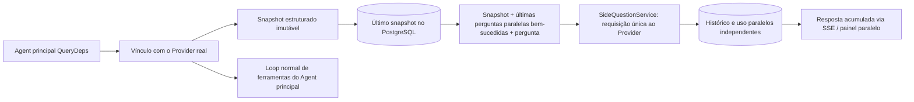

# ARTEX `/btw`

O chat comum, o MainAgent da tarefa e os próprios Workers da tarefa atual suportam perguntas paralelas independentes. Basta digitar `/btw pergunta` na caixa de entrada principal para enviar; um `/btw` vazio ou o botão "pergunta paralela" abre o histórico. No desktop usa-se uma barra lateral de largura ajustável; no mobile, um Drawer.

A resposta paralela é gerada a partir do snapshot do contexto do Agent no momento do envio, com suporte a exibição em streaming, perguntas de acompanhamento, interrupção e limpeza. Fechar o painel, atualizar a página ou desconectar o SSE não cancela a requisição ao modelo. Interromper afeta apenas a pergunta paralela atual; limpar cancela as perguntas paralelas e apaga o histórico paralelo, preservando o snapshot do contexto principal.

## Limites da implementação

Reutiliza Go, norma v0.3.7, Next.js e os componentes existentes de Markdown / ResizablePanel / Drawer / AlertDialog; não modifica o código-fonte do norma nem adiciona dependências para a pergunta paralela. Planner, Workers herdados de outras tarefas e a promoção de subtarefas do tipo ferramenta ficam fora do escopo desta entrega.

- `capture.go` só marca as requisições do loop principal em `Options.Deps.CallModel / CallModelSync`. O decorador do Provider fica dentro do modelo concreto, depois da seleção externa do pool de roteamento, de modo que registra o modelo efetivamente escolhido; requisições de compactação e de resumo não sobrescrevem o snapshot.
- O snapshot é publicado no início da requisição, na resposta completa do modelo e no estado terminal da execução. Respostas parciais em geração não são publicadas; as chamadas de ferramenta mantêm o pareamento via `MessagesForAPI` do norma, e os resultados das ferramentas entram no snapshot na próxima requisição do modelo principal ou no estado terminal da execução. Uma interrupção de streaming mantém o último limite válido.
- O snapshot preserva, por cópia profunda em JSON, as mensagens estruturadas, o prompt de sistema, as definições de ferramentas e os parâmetros de geração. A inferência do modelo não segura o lock do snapshot nem transação do banco de dados.
- `SideQuestionService` chama o Provider concreto; quando necessário, gera antes um resumo paralelo, e a resposta final só pode ser reduzida e reenviada uma vez, quando o contexto inicial estoura o limite e ainda não houve saída de texto/chamada de ferramenta. Não cria agent session, não se conecta ao executor de ferramentas, ao transcript principal, ao fluxo de atividades nem ao grafo de tarefas, e também não passa pela cadeia de troca de modelo da tarefa. A resposta mantém as definições de ferramentas para ser compatível com o contexto estruturado de ferramentas existente; a requisição de resumo não fornece ferramentas. Chamadas de ferramenta recém-retornadas não têm caminho de execução.
- Uma requisição em execução por sessão-pai, no máximo quatro por processo de serviço, com timeout de 120 segundos por requisição. A pergunta paralela usa um contexto de cancelamento independente, sob o ciclo de vida do serviço.
- A requisição paralela guarda a referência à configuração do modelo e um resumo de identidade não sensível; a credencial é obtida da configuração existente no momento da requisição. Se a configuração for excluída, ou se campos de identidade como modelo, protocolo ou endereço mudarem, é preciso antes executar o Agent principal para atualizar o snapshot. Os testes não alteram o modelo padrão do produto.

## Persistência e recuperação

`db/schema.sql` cria automaticamente `side_question_sessions` e `side_question_requests`. A primeira guarda o recurso-pai, o último snapshot, o número da execução, a versão e a versão de limpeza; a segunda guarda a pergunta, a resposta acumulada, o estado, o modelo, o horário do snapshot, o uso, o número de sequência de eventos e o número de sequência de paginação.

A chave da sessão-pai usa o conversation ID, ou task ID + exploration ID + intent ID. O Worker não usa nomes de slot de execução reutilizáveis.

Os snapshots são gravados de forma mesclada por sessão-pai, com flush a cada 250 ms, e o banco compara `(run_id, version)` para impedir que versões antigas sobrescrevam. Antes de enviar a pergunta paralela, o snapshot selecionado é salvo de novo. Após o salvamento bem-sucedido, o snapshot grande em memória é liberado; em caso de falha, a versão pendente de gravação é mantida. O conteúdo acumulado da resposta é gravado no máximo a cada 250 ms conforme chegam os eventos de streaming; o estado terminal é salvo imediatamente, com número limitado de novas tentativas em caso de erro do banco.

Na inicialização, o serviço marca as requisições `running` remanescentes como `interrupted`, preserva as respostas parciais e o uso já gravados e não reexecuta a requisição automaticamente. O último contexto salvo com sucesso pode ser usado diretamente na pergunta seguinte. Sessões antigas sem snapshot exigem executar antes o Agent principal, sem reconstruir o contexto a partir dos registros de atividade da UI.

A operação de limpeza incrementa a versão de limpeza e exclui as requisições; atualizações condicionais impedem que callbacks atrasados regravem. A exclusão física do recurso-pai depende do cascade de chaves estrangeiras; a exclusão lógica do Worker apaga os dados paralelos na mesma transação e rejeita snapshots tardios subsequentes. O arquivamento de tarefa primeiro bloqueia novas requisições, espera o fluxo principal parar, cancela e espera a gravação da pergunta paralela; o formato de arquivo é v3, compatível também com v1/v2 sem tabelas paralelas.

O histórico é salvo por completo, retornando no máximo 20 itens por página com cursor por número de sequência. A requisição ao modelo reproduz no máximo os últimos 20 grupos de perguntas e respostas bem-sucedidas em texto original, também limitando o volume reproduzido pelo orçamento de tokens; as perguntas e respostas mais antigas mantêm um resumo contínuo independente. Quando o contexto principal estoura o orçamento, apenas a parte antiga da cópia paralela é resumida, preservando as chamadas de ferramenta estruturadas recentes e seus resultados. O resumo, o progresso de preparação e o uso entram juntos nos limites de concorrência, cancelamento e timeout de 120 segundos da pergunta paralela. Detalhes em [Orçamento de contexto e referências de código aberto](CONTEXT_BUDGET.md).

## Contrato HTTP

Os caminhos abaixo são tratados como `{parent}`, reutilizando a autenticação e a validação de recursos existentes:

- `/api/conversations/{id}`
- `/api/tasks/{id}/chat`
- `/api/tasks/{id}/intents/{iid}`

| Requisição | Retorno e comportamento |
| --- | --- |
| `GET {parent}/side-questions?before={ordinal}` | `items` do mais novo para o mais antigo, estado de execução `current` independente, metadados de `snapshot`, `next_cursor`; cursor 0 significa a página mais recente / sem próxima página |
| `POST {parent}/side-questions` | JSON `{ "question": "…", "client_request_id": "UUID" }`; uma requisição nova retorna 202 e o objeto da requisição; o mesmo ID com a mesma pergunta retorna o objeto existente com 200 |
| `DELETE {parent}/side-questions` | Cancela e limpa as perguntas paralelas da sessão-pai atual |
| `GET /api/side-questions/{requestID}/events` | Evento SSE `snapshot`, com `id` de sequência crescente e `data` com o objeto completo e acumulado da requisição; ao limpar, envia `cleared` |
| `POST /api/side-questions/{requestID}/cancel` | Cancelamento explícito; o estado terminal pode ser lido do histórico ou do SSE |

Limite da pergunta: 4000 caracteres. Ausência de snapshot, mudança na configuração do modelo, sessão-pai ocupada ou conflito de ID de idempotência retornam 409; o limite global de concorrência retorna 429. Cada conexão SSE envia primeiro o estado acumulado, sem depender dos fragmentos de texto recebidos antes pelo cliente. O front-end mescla por ID da requisição + número de sequência e descarta callbacks antigos ao trocar de sessão-pai ou ao limpar.

## Validação e referências

As verificações automatizadas, o uso real de modelos e as limitações conhecidas estão em [VALIDATION.md](VALIDATION.md).

Referência de requisição independente: [Grok CLI side-question.ts (commit fixo)](https://github.com/superagent-ai/grok-cli/blob/fb97af83f06dca873281d60168430f06c8de6324/src/utils/side-question.ts); referência de isolamento de execução: [OpenCode (commit fixo)](https://github.com/anomalyco/opencode/tree/b3f1a96c6dd7adeb28b36dd11add1998fc84d67b). O contexto do ARTEX usa as mensagens estruturadas do norma, sem adotar a abordagem de montar texto a partir dos logs do front-end.
