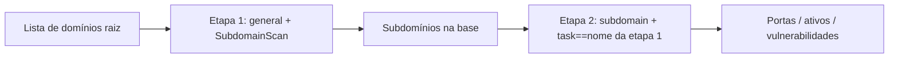

---

## name: scopesentry-mcp
description: Gerencia a plataforma de varredura de segurança pelo MCP do ScopeSentry (projetos, tarefas, modelos, ativos, nós). Use quando o usuário mencionar ScopeSentry, MCP, API Key, tarefa de varredura ou consulta de ativos.

# Guia de uso do MCP do ScopeSentry

Para quem **já tem uma instância do ScopeSentry no ar**. A conexão com a plataforma é feita pelo Cursor (ou outro cliente MCP), sem precisar do código-fonte local.

## 1. Preparação

### 1.1 Confirmar que o serviço está acessível

- Interface web padrão: `http://<host>`
- Endpoint MCP: `http://<host>/mcp` (se houver proxy reverso ou proxy de frontend na frente, vale o endereço `/mcp` real)

### 1.2 Criar uma API Key

1. Entre na interface web do ScopeSentry pelo navegador
2. Vá à página de gerenciamento de **API Key** e crie uma chave (ou peça ao administrador que crie pela API)
3. Guarde a string `ssk_...` devolvida (**ela só aparece uma vez**)

### 1.3 Configurar o MCP no Cursor

Cursor → Settings → MCP → adicionar servidor:

```json
{
  "mcpServers": {
    "scopesentry": {
      "url": "http://<seu-host>:8082/mcp",
      "headers": {
        "X-API-Key": "ssk_sua_chave"
      }
    }
  }
}
```

Também funciona: `Authorization: Bearer ssk_sua_chave`

Depois de configurar, reinicie o MCP ou recarregue o Cursor e confirme que `list_projects`, `list_assets` e companhia aparecem na lista de ferramentas.

---

## 2. Visão geral das ferramentas


| Ferramenta             | Para que serve    |
| ---------------------- | ----------------- |
| `list_projects`        | Árvore de projetos agrupada por etiqueta (com o ID do projeto) |
| `list_projects_data`   | Lista paginada de projetos, com busca por nome |
| `get_project`          | Detalhes do projeto |
| `create_project`       | Cria um projeto     |
| `list_tasks`           | Lista de tarefas de varredura |
| `get_task`             | Detalhes da tarefa  |
| `list_scan_templates`  | Lista de modelos de varredura |
| `get_scan_template`    | Detalhes do modelo  |
| `list_plugin_modules`  | Nomes dos módulos do fluxo de varredura |
| `list_plugins`         | Plugins disponíveis (com hash e parâmetros padrão) |
| `create_scan_template` | Cria um modelo de varredura |
| `create_scan_task`     | Cria uma tarefa de varredura |
| `list_assets`          | Consulta ativos de todos os tipos (lista paginada) |
| `count_assets`         | Conta os ativos (`/api/assets/common/total`) |
| `get_asset_detail`     | Detalhes de um ativo ou de uma vulnerabilidade |
| `add_asset_tag`        | Adiciona uma etiqueta a um ativo |
| `list_nodes`           | Lista de nós de varredura |


Os parâmetros de cada ferramenta são os do schema MCP. `list_assets` e `count_assets` usam a mesma sintaxe de search e filter; antes de consultar ativos, vale ler a descrição de `list_assets`.

Para saber "quantos registros existem", use `count_assets` (equivale ao total de páginas da interface web), em vez de paginar `list_assets` repetidamente só para contar.

---

## 3. Fluxos comuns

### 3.1 Consultar ativos por projeto

Quando o usuário ou o contexto **já trazem o projeto**, passe `filter.project` para reduzir o alcance: sem isso, o volume entre projetos deixa a resposta lenta. Sem projeto definido, não é obrigatório filtrar.

1. `list_projects` ou `list_projects_data` para obter o **ObjectID** do projeto (`id` / `children[].value`)
2. `list_assets` com `filter.project` (**tem de ser o ID, nunca o nome do projeto**)

```json
{
  "asset_type": "asset",
  "pageIndex": 1,
  "pageSize": 20,
  "search": "domain=^example.com",
  "filter": {
    "project": ["<ObjectID do projeto>"]
  }
}
```

### 3.2 Criar uma tarefa de varredura

1. `list_nodes` para obter os nomes dos nós online
2. `list_scan_templates` ou `create_scan_template` para obter o **ObjectID** do modelo
3. `create_scan_task`: `name` e `node` são obrigatórios e `template` recebe o ID do modelo (não o nome)

**Origem dos alvos, `targetSource` (igual à interface web):**

| targetSource | Descrição | Parâmetros obrigatórios |
| --- | --- | --- |
| `general` | Alvos digitados direto | `target` |
| `project` | Lê os alvos de um projeto | `project` (lista de ObjectIDs) |
| `asset` | Busca na base de ativos web | `search`; opcionais: `project`, `filter`, `targetNumber` |
| `RootDomain` | Busca na base de domínios raiz | `search`; opcionais: `project`, `filter`, `targetNumber` |
| `subdomain` | Busca na base de subdomínios | `search`; opcionais: `project`, `filter`, `targetNumber` |
| `UrlScan` | Busca nos resultados de varredura de URL | `search`; opcionais: `project`, `filter`, `targetNumber` |
| `*Source` (ex.: `subdomainSource`) | Criada a partir da seleção ou busca na página de ativos | com `targetTp=search`, use `search`; com `targetTp=select`, use `targetIds` |

**Exemplo — varrer domínios raiz direto:**

```json
{
  "name": "example-coleta-de-subdominios",
  "node": ["node-1"],
  "template": "<ObjectID do modelo>",
  "targetSource": "general",
  "target": "example.com\nfoo.com",
  "project": ["<ObjectID do projeto>"]
}
```

**Exemplo — continuar da base de subdomínios (filtrando pelo nome da tarefa anterior):**

```json
{
  "name": "example-portas-e-vulnerabilidades",
  "node": ["node-1"],
  "template": "<ObjectID do modelo dos módulos seguintes>",
  "targetSource": "subdomain",
  "search": "task==\"example-coleta-de-subdominios\"",
  "project": ["<ObjectID do projeto>"]
}
```

### 3.3 Coleta completa a partir de domínios raiz (duas etapas, recomendado)

Quando a entrada é um **domínio raiz** e o objetivo é uma **coleta completa**, vale dividir em duas varreduras em vez de rodar o fluxo inteiro de uma vez.

**Motivo:** as tarefas distribuídas são repartidas **por alvo**. Com o domínio raiz como alvo, o nó que o receber também executa nele os módulos seguintes sobre todos os subdomínios descobertos, o que desequilibra a carga, deixa tudo mais lento e favorece erros.

**Melhor prática:**

1. **Etapa 1 — apenas coleta de subdomínios**
   - `targetSource`: `general`
   - `target`: todos os domínios raiz (um por linha)
   - Modelo: habilitar só `SubdomainScan` e `SubdomainSecurity` (varredura e tomada de subdomínio)
   - Acompanhe a conclusão com `get_task`

2. **Etapa 2 — módulos seguintes**
   - `targetSource`: `subdomain`
   - `search`: `task=="<nome da tarefa da etapa 1>"` (correspondência exata do nome)
   - `project` é opcional, para reduzir o alcance
   - Modelo: varredura de portas, mapeamento de ativos, varredura de vulnerabilidades etc. (sem precisar do SubdomainScan)
   - Cada subdomínio vira um alvo independente distribuído entre os nós, com paralelismo bem melhor

O mesmo efeito se obtém filtrando por nome de tarefa na página de ativos "Subdomínios" da interface web e usando "criar tarefa a partir dos subdomínios".



### 3.4 Criar um modelo de varredura

1. `list_plugin_modules` → lista de nomes de módulos
2. `list_plugins` (dá para filtrar por `module`) → o `hash` e o `parameter` padrão de cada plugin
3. `create_scan_template`: em `modules`, mapeie "módulo → lista de hashes de plugin"

---

## 4. Consulta de ativos (`list_assets` / `count_assets`)

`count_assets` usa os mesmos `asset_type`, `search` e `filter` de `list_assets` e devolve `{ "total": N }`, equivalente ao `/api/assets/common/total` da interface web.

```json
{
  "asset_type": "subdomain",
  "search": "task==\"nome de alguma tarefa\"",
  "filter": {"project": ["<ObjectID do projeto>"]}
}
```

**Desempenho (vale para `list_assets` e `count_assets`):** havendo projeto definido, use `filter.project` para reduzir o alcance; no `search`, prefira `==` (igualdade) ou `^` (prefixo) nos campos indexados (ver [4.3](#43-expressões-de-busca-search)), evitando buscas difusas com `=` em grande volume. Sem contexto de projeto, não é obrigatório filtrar.

Os tipos que aceitam `filter.project` estão na tabela de [4.4](#44-filtro-exato-filter).

### 4.1 Tipos de ativo (`asset_type`)

`asset`, `RootDomain`, `subdomain`, `app`, `mp`, `UrlScan`, `SensitiveResult`, `DirScanResult`, `crawler`, `vulnerability`, `PageMonitoring`, `IPAsset`, `SubdomainTakerResult`

Exemplos de apelido: `web` → asset, `vuln` → vulnerability, `ip` → IPAsset, `url` → UrlScan

### 4.2 Parâmetros


| Parâmetro                | Descrição                                 |
| ------------------------ | ----------------------------------------- |
| `pageIndex` / `pageSize` | Paginação; padrão 1 / 20                  |
| `search`                 | Expressão de busca (ver a seção seguinte) |
| `filter`                 | Filtro exato em JSON (ver a seção seguinte) |
| `sort`                   | Só UrlScan e DirScanResult aceitam ordenação por `length` |
| `sid`                    | Só SensitiveResult: nome da regra de dado sensível |


`search` e `filter` **podem ser usados juntos**.

### 4.3 Expressões de busca (`search`)

É uma DSL própria (**não é SQL**):


| Operador | Significado | Índice | Exemplo |
| ---- | ---- | ---- | --------------------------- |
| `=`  | Correspondência difusa (regex) | não usa índice | `domain=example` |
| `==` | Correspondência exata | **usa índice** | `port==443` |
| `!=` | Exclusão | — | `port!="80"` |
| `&&` | E | — | `domain==example.com && port==443` |
| `\|\|` | Ou | — | `title=admin \|\| body=login` |


**Índices e operadores:** campos como `domain`, `ip`, `port` e `title` são indexados, mas só a **igualdade `==`** ou o **prefixo com `^`** (por exemplo `domain=^example.com`) aproveitam o índice; **`=` vira regex difuso e não usa índice**, o que fica lento em volume grande.

**Campos de search comuns a todos os tipos:** `tag`, `task` (nome da tarefa), `rootDomain`

**`project` não vai no search** (é ignorado ou dá erro quando combinado com `&&`). Para filtrar por projeto, use `filter.project`.

**Campos de search mais usados por tipo:**


| asset_type           | Campos |
| -------------------- | ----------------------------------------------------------------------------------- |
| asset                | domain, ip, port, service, app, title, statuscode, icon, banner, type, body, header |
| RootDomain           | domain, icp, company |
| subdomain            | domain, ip, type, value |
| app                  | name, icp, company, category, description, url, apk |
| mp                   | name, icp, company, category, description, url |
| UrlScan              | url, input, source, resultId, type |
| SensitiveResult      | url, sname, body, info, md5 |
| DirScanResult        | url, statuscode, redirect, length |
| vulnerability        | url, vulname, matched, request, response, level |
| crawler              | url, method, body, resultId |
| PageMonitoring       | url, hash, diff, response |
| IPAsset              | ip, domain, port, service, webServer, app |
| SubdomainTakerResult | domain, value, type, response |


**Exemplos de search:**

- `domain==www.example.com && port==443` (igualdade, usa índice)
- `domain=^example.com` (prefixo, usa índice)
- `ip==192.168.1.1`
- `task=="nome de alguma tarefa"`
- `level==high` (vulnerability)
- `statuscode==200` (DirScanResult)

Para "contém", use `=`, como em `title=admin` (não usa índice, então vale combinar com projeto ou outro filtro para reduzir o alcance).

### 4.4 Filtro exato (`filter`)

Objeto JSON: vários valores na mesma chave são **OU**, chaves diferentes são **E**.

**Com projeto definido, use `project`:** se o usuário ou o contexto já deixaram o projeto claro e o `asset_type` aceita `project`, inclua para reduzir o alcance; sem essa informação, não é obrigatório.


| Chave de filter | Significado | Valores |
| ------------ | -------- | -------------------------------------------------------- |
| `project`    | Projeto ao qual pertence | **ObjectID**, obtido por `list_projects` / `list_projects_data` |
| `task`       | Tarefa de origem | **Nome da tarefa**, o campo `name` de `list_tasks` |
| `port`       | Porta | por exemplo `"443"` |
| `service`    | Serviço/protocolo | por exemplo `"https"` |
| `app`        | Impressão digital da aplicação | por exemplo `"Nginx"` |
| `icon`       | Hash do ícone | |
| `statuscode` | Código HTTP | usado sobretudo em asset |
| `status`     | Estado | código HTTP em UrlScan/DirScan; estado de tratamento em vulnerabilidade e dado sensível |
| `level`      | Severidade da vulnerabilidade | critical / high / medium / low / info |
| `type`       | Tipo | por exemplo o tipo de registro do subdomínio: A, CNAME |
| `color`      | Cor da regra de dado sensível | SensitiveResult |
| `sname`      | Nome da regra de dado sensível | SensitiveResult |
| `tags`       | Etiquetas | |


**Chaves de filter aceitas por tipo:**


| asset_type                            | Chaves de filter |
| ------------------------------------- | --------------------------------------------------------------- |
| asset                                 | project, port, service, app, icon, statuscode, type, task, tags |
| RootDomain                            | project, tags |
| subdomain                             | project, type, task, tags |
| app / mp                              | project, tags |
| UrlScan                               | status, tags |
| DirScanResult                         | status, tags |
| SensitiveResult                       | status, color, sname, tags |
| crawler                               | project, task, tags |
| vulnerability                         | project, level, status, task, tags |
| PageMonitoring / SubdomainTakerResult | tags |
| IPAsset                               | project, port, service, app |


**Exemplo de filter:**

```json
{"project": ["<ObjectID do projeto>"], "port": ["443"]}
```

**Exemplo de consulta combinada:**

```json
{
  "asset_type": "asset",
  "search": "domain=^example && port==443",
  "filter": {"project": ["<ObjectID do projeto>"]},
  "pageIndex": 1,
  "pageSize": 10
}
```

**Atenção:**

- Com projeto definido, inclua `filter.project` (quando o tipo aceitar); sem contexto de projeto, não é obrigatório
- Não coloque o nome de exibição do projeto em `filter.project`
- Com o valor exato em mãos, use `==`; para prefixo, `^`; evite abusar do `=` difuso em tabelas grandes
- O código HTTP do UrlScan vai em `filter.status`; no DirScanResult dá para usar `statuscode==200` no search
- Para filtrar SensitiveResult pelo nome da regra: `sname=nome da regra` no search, ou `filter.sname`

### 4.5 Ordenação (`sort`)

Só **UrlScan** e **DirScanResult** aceitam:

```json
{"length": "ascending"}
```

Os demais tipos ignoram `sort` e seguem a ordenação padrão por data.

---

## 5. Nomes dos módulos de modelo de varredura

`TargetHandler`, `SubdomainScan`, `SubdomainSecurity`, `PortScanPreparation`, `PortScan`, `PortFingerprint`, `AssetMapping`, `AssetHandle`, `URLScan`, `WebCrawler`, `URLSecurity`, `DirScan`, `VulnerabilityScan`, `PassiveScan`

---

## 6. Resolução de problemas


| Sintoma | O que fazer |
| --------- | -------------------------------------------------- |
| O MCP não lista ferramentas | Verifique a URL, a API Key e se o ScopeSentry está no ar |
| 401 / 403 | Recrie ou troque a API Key |
| Os ativos não aparecem | Confirme que `filter.project` é o ObjectID e que `project` não está no search |
| Falha ao criar modelo ou tarefa | `template` precisa ser o ObjectID do modelo e `node`, o nome de um nó online |
| Consulta lenta ou travando | Havendo projeto, adicione `filter.project`; no search, troque `=` por `==` ou pelo prefixo `^` nos campos indexados; reduza o `pageSize` |


---
